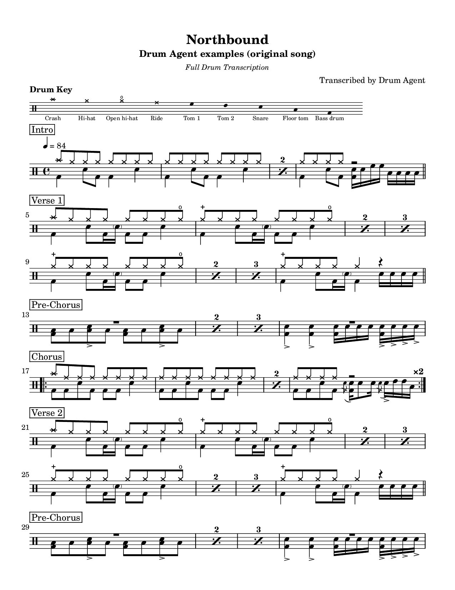

# Drum Agent

Engraved drum sheet music from a song name, audio, MIDI, a Rock Band / Clone
Hero chart or a written groove: real notation (LilyPond), editable MusicXML and
MIDI, all generated from one structured score and checked against each other
automatically. Comes with a library of 113 charts: the 40 PAS rudiments and 73
grooves and fills.



- **Engraving**: LilyPond 2.26. Cymbals stems up, drums and feet stems down
  (the Guitar Pro / Songsterr look; `--voicing hands-up` gives the
  Weinberg/PAS drum-book layout), sticking under the staff, cues above it, a
  "Swing" mark with its rhythm, Drum Key, boxed section labels, simile marks,
  repeats, multi-bar rests, tuplets, flams, drags, rolls, ghost notes,
  accents, open/closed hi-hat, meter and tempo changes, pickups. The spec is
  in [docs/NOTATION_SPEC.md](docs/NOTATION_SPEC.md).
- **Inputs**: a song's name (identified from public metadata; audio from your
  own files, a link, or a video page through your own yt-dlp; streaming
  services are metadata only), audio you're allowed to transcribe, GM MIDI
  drum tracks, Rock Band / Clone Hero charts, or YAML chart specs.
- **Listening**: candidate onsets from the spectrogram, then a neural onset
  classifier trained on synthesized drumming from 40+ sampled kits in many
  recording conditions ([docs/MODELS.md](docs/MODELS.md)), measured on real
  recordings (MDB Drums) as well as synthetic ones.
- **Honesty**: every chart says whether it's a full transcription, a
  performance chart or a pattern study, and whether a human verified it.
  Uncertain bars are marked "(?)". The report separates *rendering
  correctness* (automatic) from *transcription confidence* (needs a listen).
  Measured accuracy and known weaknesses: [docs/LIMITATIONS.md](docs/LIMITATIONS.md).

## Setup

Requires Python 3.10+ and LilyPond 2.24 or newer (2.26 recommended).

```bash
pip install -e .            # add [test] for pytest + verovio
scripts/install_lilypond.sh # official LilyPond 2.26 binary into /opt (or: apt-get install lilypond)
python -m drum_agent doctor # checks everything
```

Optional: `ffmpeg` (MP3/M4A input), `fluidsynth` + `fluid-soundfont-gm`
(synthesizing audio fixtures for tests and evaluation). If LilyPond lives
somewhere else, set `DRUM_AGENT_LILYPOND=/path/to/lilypond`.

## Use

```bash
# A chart you write (see .claude/skills/drum-chart/reference/chart-spec.md)
python -m drum_agent render examples/specs/01_basic_rock_beat.yaml -o out/basic

# A MIDI drum track (e-kit, DAW export)
python -m drum_agent midi groove.mid --title "Groove" --rights own -o out/groove

# An audio recording you own or have permission to transcribe
python -m drum_agent transcribe song.wav --rights own --title "Song" --artist "Band" -o out/song
#   hints when you know them: --bpm 96 --time-signature 6/8 --downbeat 1.23 --drums-only
#   --sections "Intro:1,Verse:5,Chorus:13"

# Without transcription rights: tempo, meter and form only, no notes
python -m drum_agent analyze song.wav

# A song by name: identify it, find audio (your library, --audio, --url, or your own yt-dlp),
# check its length, then analyse; with --rights (and --pick N after a search) transcribe it
python -m drum_agent song "Song Title" --artist "Band"
python -m drum_agent song "Song Title" --artist "Band" --pick 1 --rights own -o out/song

# A Rock Band / Clone Hero chart (notes.mid, notes.chart or the song folder)
python -m drum_agent gamechart "Songs/Band - Title" -o out/title

# A chart from the library
python -m drum_agent render library/rudiments/r16_single_paradiddle.yaml -o out/paradiddle

# Fix what you hear is wrong, then re-render
python -m drum_agent edit out/song/song.json --relabel ride=hihat --bars 9-16 \
    --delete 12:7/8:kick --add 12:3/8:snare:ghost --render out/song
```

Each run writes `<stem>.pdf`, `<stem>.png` (or `-pageN.png`), `<stem>.musicxml`,
`<stem>.mid`, `<stem>.ly`, `<stem>.json` (the score) and `<stem>.report.md`. It
never writes over its input (pick another `-o` folder or `--stem`).

Other commands: `synth` (chart to audio), `evaluate` (compare a transcription
with a known chart), `verify` (re-check exported files; pass the same `--kit` if
they were rendered with one), `doctor`.

## With Claude Code

The skill in `.claude/skills/drum-chart/` teaches Claude the whole workflow:
choosing the chart type, the rights check, transcription hints, reading the
report, checking every page against a QC checklist, correcting with `edit`,
and delivering honestly. Ask for "a drum chart of ..." or run
`/drum-chart <file or description>`.

## Examples

`examples/specs/` holds original charts from a single groove to a full song.
`library/` holds the 113-chart library ([index](library/README.md)).
`examples/output/` has their rendered PDFs, PNGs, MusicXML and MIDI, plus an
audio transcription of the full song (`05_audio_transcription/`) made from a
synthesized band recording.

## Tests

```bash
python -m pytest -q                 # everything
python -m pytest -q -m "not slow"   # skip audio end-to-end tests
python scripts/eval_notation.py --jobs 4   # transcription accuracy, end to end
python scripts/eval_detection.py           # stroke detection per instrument
python scripts/eval_real.py --split train  # real recordings (MDB Drums, cached locally)
```

## Documentation

- [docs/NOTATION_SPEC.md](docs/NOTATION_SPEC.md): the notation contract
- [docs/ARCHITECTURE.md](docs/ARCHITECTURE.md): how it works
- [docs/LIMITATIONS.md](docs/LIMITATIONS.md): measured accuracy and limits
- [docs/MODELS.md](docs/MODELS.md): the onset classifier, its data and licences
- [docs/SONG_LOOKUP.md](docs/SONG_LOOKUP.md): from a song's name to a chart
- [docs/GAMECHARTS.md](docs/GAMECHARTS.md): Rock Band / Clone Hero import
- [docs/AUDIT.md](docs/AUDIT.md): the starting point and the plan
